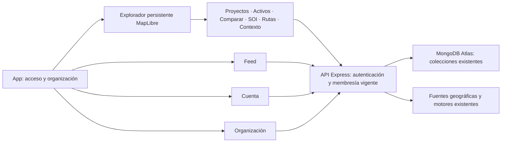

# BACKSTAGE · arquitectura Origin

## Arquitectura vigente · 26 de octubre de 2026

[Community contextual](BACKSTAGE_COMMUNITY.md) reutiliza las familias documentales normativas cifradas como registro único de cuerpos documentales. Extiende su adaptador a objetos canónicos de `locations`, conservando la evaluación legal restringida a PH. Análisis y acuerdos de acceso se versionan como referencias cifradas separadas, sin copiar cuerpos ni extractos; la interfaz recupera las frases desde la fuente autorizada. Identity/Security/Hebra conserva aislamiento, sesiones, integridad y auditoría. El intercambio de una versión concreta exige dos aprobaciones, vinculación al objeto receptor y revalidación transaccional; modificaciones, eliminación y revocación impiden nuevas lecturas. El Feed mantiene sus publicaciones y Colab permanece pendiente. Todo se abre desde el Explorador, con navegación y dependencias conservadas.

La [inteligencia normativa colombiana](BACKSTAGE_NORMATIVE_INTELLIGENCE.md) separa fuentes oficiales, interpretaciones revisadas, reglas formales permitidas por código, hechos tipados y evaluaciones. El núcleo transversal tiene adaptador PH contextual; consume evidencia económica reproducida y verifica su alcance documental. Las versiones cifradas permanecen en eventos discriminados Atlas y las acciones en la cadena Hebra. Identity revalida rol y designación de revisión por copropiedad. Los documentos aportados se tratan como datos inertes, sin alterar instrucciones ni reglas. La revisión humana preserva la conclusión automatizada original y sus discrepancias; no hay otro módulo o navegación.

La [inteligencia económica contextual](BACKSTAGE_ECONOMIC_INTELLIGENCE.md) añade un núcleo neutral de planificación que reutiliza las fracciones exactas existentes y un adaptador PH al libro de hechos autenticados. Caja/cartera, supuestos, proyecciones, asignación presupuestaria y propuestas de cuotas producen evidencia cifrada/versionada en eventos discriminados Atlas. Hebra sella paquetes acotados con el cifrado existente; Identity revalida organizaciones/roles. Reproducción y aprobación verifican huellas, versión del motor y vigencia de la base. El Explorador muestra sus resultados y una capa categórica de saldos; no hay aplicación o navegación paralela ni nuevos proveedores obligatorios.

La [integración espacial contextual](BACKSTAGE_SPATIAL_CONTEXT_INCREMENT.md) extiende servicios PH y reutiliza BSIE sin alterar sus algoritmos. El Explorador captura conjuntos por objeto, ejecuta análisis acotados y conserva entradas/resultados cifrados con Hebra en eventos discriminados, aislados de las rutas generales de alertas. La identidad y autorización vigentes se revalidan antes de publicar cada cálculo. No se añade navegación ni un motor matemático paralelo.

Backstage Identity, Security y Hebra amplían infraestructura nativa compartida; no dependen de SATYA, Vault ni Sincronía. PH opera sobre activos canónicos y versiones cifradas de eventos, desde paneles del Explorador. MFA amplía autenticación/sesiones existentes, sin otro directorio ni navegación. [Responsabilidades y decisiones técnicas](BACKSTAGE_NATIVE_TRUST_ARCHITECTURE.md), [implementación y aceptación](BACKSTAGE_UNIFIED_OPERATIONS_REPORT.md), [plan actualizado](BACKSTAGE_UNIFIED_INCREMENTAL_PLAN.md). Los expedientes Origin/fase 2 que siguen son antecedentes; no sustituyen esta corrección.

## Evolución backend de fase 2 · 25 de octubre de 2026

El [expediente de arquitectura actual](BACKSTAGE_PHASE2_ARCHITECTURE.md) documenta las capas y adaptadores incorporados, preservando Atlas, los motores y las vistas. Los resultados Origin posteriores conservan su fecha histórica. [Aceptación técnica y límites de operación](BACKSTAGE_PHASE2_TEST_REPORT.md).

Estado de implementación: 24 de octubre de 2026 (Bogotá). Incremento compatible sobre BACKSTAGE 3.1.0. La publicación original mantiene su versión; la validación del incremento se realiza en Preview protegido y Atlas confirmado como pruebas.

## Experiencia y servicios

`frontend/src/lib/navigationRegistry.mjs` define cuatro destinos principales. Las URLs anteriores siguen resolviendo: las capacidades operacionales se abren como paneles de `ExplorerWorkspace.jsx`. El mapa permanece montado al cambiar herramientas; Cuenta, Feed y Organización ocultan el espacio territorial sin destruirlo. `CapabilityBoundary.jsx` contiene fallos por capacidad y permite reintentar con una referencia de diagnóstico sin registrar datos del usuario.

`App.jsx`, `operationalContext.js`, `territory.js` y `projectContext.mjs` adaptan el contexto existente. El estado de interfaz guarda usuario/organización, territorio explorado, territorio canónico del proyecto, proyecto, selección de activos/candidatos, comparación, cámara, vista y preferencias de capas. La información durable se recupera de Atlas; la caché del navegador no sustituye las entidades del servidor. Una respuesta tardía del proyecto se integra con el estado vigente y no reemplaza una comparación que el usuario acaba de abrir.

## Persistencia y límites

Se conserva el driver MongoDB y `platformMongo`, con transacciones para identidad, Feed y vínculos de evidencia. No se incorpora SQL, PostgreSQL ni PostGIS. Las organizaciones aíslan las consultas; cada endpoint comprueba permisos en el servidor y obtiene membresías vigentes. `analysis_runs`, `locations`, `soi_assets`, `soi_comparisons` y `operational_events` siguen siendo las fuentes de verdad existentes.

Los motores financieros, Monte Carlo, comparaciones, GIS y optimización conservan sus contratos y versiones. Las nuevas capas de experiencia consumen sus resultados y procedencia. No se cambia una fórmula para acomodar la interfaz. El entorno serverless utiliza consulta HTTP periódica cuando no dispone de WebSocket persistente.

## Inteligencia contextual y espacial

Los paneles actuales muestran resultados, datos faltantes, parámetros y fuentes reales. Una futura integración de modelos debe recibir únicamente evidencia accesible por organización, devolver referencias de las evidencias utilizadas y separar recomendaciones de acciones. No hay un proveedor de IA contextual nuevo conectado ni respuestas generadas presentadas como hechos. Cualquier acción crítica debe pasar por los endpoints, roles y aprobaciones existentes.

Las futuras fuentes orbitales/satelitales deben aportar proveedor, licencia, fecha de captura, resolución, sistema de referencia, cobertura y disponibilidad. Su ingestión se integrará con el catálogo/importador espacial existente, con geometrías acotadas y trabajo asíncrono. No se crean telemetría orbital, tráfico, calidad del aire ni ubicación de flotas artificiales para llenar el mapa.

## Rendimiento

MapLibre se carga de forma diferida. Se conserva una instancia de mapa y se actualizan fuentes/capas; los modos 2D/3D/globo cambian esa instancia. Búsqueda predictiva: mínimo tres caracteres, espera de 600 ms, cancelación de consultas anteriores y cuota de servidor por organización. Las listas nuevas tienen límites; Feed agrupa las consultas de referencias y comentarios. La compilación advierte sobre el tamaño del motor cartográfico: no equivale a una prueba de carga ni certifica rendimiento en dispositivos físicos modestos.

## Acceso · incremento del 25 de octubre de 2026

La identidad sigue en Atlas. Un servicio de seguridad confirma hashes temporales de un solo uso y registra versiones/sesiones dentro del usuario existente. Los middleware de organización y WebSocket consultan esa vigencia; JWT mantiene su firma y duración. El transporte de correo es un adaptador servidor, desactivado sin configuración; no se incorpora Supabase ni una segunda base. [Aceptación real, diseño y reversión](BACKSTAGE_ACCOUNT_SECURITY.md).
