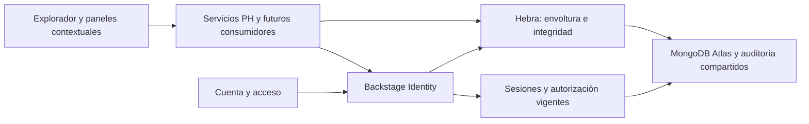

# BACKSTAGE · identidad, seguridad y confianza nativas

26 de octubre de 2026, Bogotá. Decisión arquitectónica vigente: **BACKSTAGE autónomo primero**. La corrección del propietario sustituye cualquier dependencia previa de SATYA, Vault o Sincronía Nativa. No se implementan esos productos, sus clientes provisionales ni contratos vacíos. Su interoperabilidad futura sería opcional.

## Responsabilidades compartidas

| Capa | Implementación y responsabilidad | Límite actual |
| --- | --- | --- |
| Backstage Identity | Identidad MongoDB existente: usuarios, organizaciones, invitaciones, roles, sesiones, registro/acceso y recuperación. Se amplía con TOTP y códigos de recuperación de un solo uso. | No verifica identidad civil ni afirma conexión a registros oficiales. El correo de recuperación existente sigue sin proveedor configurado. |
| Backstage Security | Middleware de autorización, sesión vigente, aislamiento, cuotas y protección de claves. AES-256-GCM para cuerpos sensibles de operaciones PH y secretos TOTP. | No se presenta como KMS administrado, auditoría integral de seguridad ni certificación de cumplimiento. |
| Hebra | Compromisos criptográficos, envolturas cifradas versionadas, registro de versiones y auditoría encadenada existentes, con historial por objeto. | No hay firma digital de personas, IPFS, blockchain ni repositorio documental Community completo habilitados en este incremento. |

No se crean directorios de usuarios, roles sectoriales o navegación adicionales. El Explorador conserva cuatro destinos; las operaciones aparecen en el panel de la entidad PH seleccionada. Cuenta contiene la configuración personal de MFA, utilizando su pantalla existente.

## Decisiones técnicas

1. Se conserva Node/Express, React/MapLibre, MongoDB Atlas y los motores actuales. No se añade Docker, paquetes, servicios pagos ni instalaciones pesadas.
2. La identidad existente se amplía; no se sustituye ni se llama SATYA. El segundo factor usa HMAC de Node y el procedimiento descrito en [RFC 6238](https://www.rfc-editor.org/rfc/rfc6238) y [RFC 4226](https://www.rfc-editor.org/rfc/rfc4226), con pruebas de sus vectores. No se inventa un algoritmo criptográfico.
3. TOTP operativo: seis dígitos, periodos de treinta segundos, tolerancia de un paso y rechazo de pasos ya consumidos. La activación exige contraseña y prueba del autenticador; confirmación y desactivación renuevan la sesión nativa y revocan las anteriores.
4. Contraseña correcta con MFA habilitado devuelve un desafío opaco de dos minutos, no un JWT de sesión. Cinco errores bloquean ese desafío y registran una alerta interna sin códigos ni credenciales. La limitación de solicitudes complementa ese límite; no se afirma alerta externa recibida.
5. Diez códigos de recuperación aleatorios se muestran una vez. Solo sus hashes se guardan; cada consumo es transaccional y no se puede repetir. No recuperan una contraseña olvidada por sí solos.
6. Las claves maestras son de 32 bytes, identificadas y suministradas al servidor mediante `HEBRA_ENCRYPTION_KEYS` y `HEBRA_ACTIVE_KEY_ID`. No hay clave por defecto ni generación silenciosa. Ausencia o configuración inválida impide escribir contenido protegido.
7. Cada versión cifrada usa una clave de datos aleatoria y AES-256-GCM; esa clave se guarda envuelta por una clave maestra. Nonces y etiquetas son propios de cada cifrado. La autenticación adicional vincula organización, objeto, registro, revisión, autor y estado, evitando trasladar cuerpos entre contextos.
8. Los compromisos almacenados son hashes de la envoltura cifrada aleatorizada. No se conserva un hash público del texto personal que facilite adivinar contenido de baja entropía. Los importes y fechas financieras se obtienen del cuerpo cifrado; no se duplican como importes legibles en los metadatos de persistencia.
9. Rotar la clave activa conserva lectura de claves anteriores mientras estén autorizadas en el anillo. Retención, custodia externa y recuperación de esas claves son requisitos operativos pendientes; eliminar una clave necesaria impide leer sus registros.
10. Se reutiliza operational_events con discriminador explícito para versiones PH, y la cadena canónica por organización. Las rutas generales de alertas excluyen esas versiones para evitar acceso fuera de su política. El logger HTTP omite cuerpos PH y de autenticación.
11. El historial contextual comprueba las huellas de las filas mostradas; la comprobación de toda la cadena organizacional es separada y respeta el límite del verificador existente. Ninguna de ellas convierte un hash en firma digital o certificación jurídica.
12. La eliminación autorizada de contenido personal cerrado retira envolturas y claves de datos de todas sus versiones activas en Atlas. Conserva referencias técnicas y auditoría de la eliminación. No borra automáticamente respaldos, exportaciones o la identidad del actor; no certifica anonimización universal ni cumplimiento legal.
13. Los movimientos financieros registrados son inmutables en su importe y se corrigen con anulación versionada, motivo y restricciones de saldo. Son asientos manuales aportados por la organización; no representan pasarela, conciliación bancaria ni facturación electrónica.
14. La norma inicial es Colombia, confirmada por el propietario. La investigación normativa partirá de fuentes oficiales, con revisión de aplicabilidad, vigencia y ambigüedad. Los estados legales y las obligaciones no se infieren de un registro de asamblea o una suma de cartera.

## Contratos y fases siguientes

Servicios: `mongoIdentity.service`, `identityMfa.service`, `hebraCipher.service`, `propertyOperations.service`; rutas dentro de `/auth/mfa` y `/assets/layers/horizontal-property/:id/operations`. El OpenAPI compartido incorpora los contratos nuevos. Las operaciones y las versiones continúan ligadas al activo canónico, sin una aplicación independiente.

Pendientes de fases posteriores: diccionario normativo versionado y evaluador, integración contextual de BSIE con datos operativos, optimización/proyecciones económicas, documentos Community y colaboración formal Colab. Estas funciones ya están autorizadas en la visión, pero no se declaran implementadas por existir esta infraestructura.

Fuentes iniciales para investigar, sin afirmar evaluación legal ya realizada: [Ley 1581 de 2012, Función Pública](https://www.funcionpublica.gov.co/eva/gestornormativo/norma.php?i=49981) y [normatividad del Ministerio del Interior](https://www.mininterior.gov.co/normatividad-mininterior/). La consulta directa al texto de Ley 675 en Secretaría del Senado no respondió durante esta revisión; no se extrajeron reglas automáticas de una fuente inaccesible.

La aceptación nueva y sus límites se registran en el [informe del incremento operativo](BACKSTAGE_UNIFIED_OPERATIONS_REPORT.md). La publicación productiva sigue retenida por los pendientes de Atlas, monitoreo, claves y aceptación existentes.
