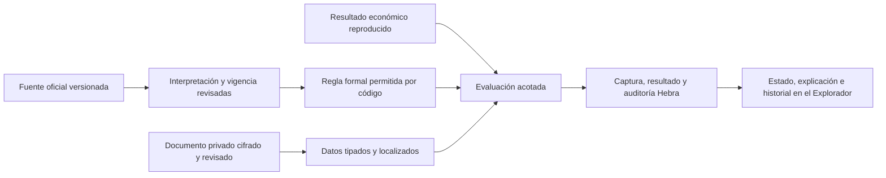

# BACKSTAGE · inteligencia normativa de Colombia

Incremento del 26 de octubre de 2026. Se integra en **Explorador → copropiedad → Operaciones e historial → Revisar obligaciones y evidencia normativa**. No hay navegación paralela, base distinta de MongoDB Atlas, directorio nuevo de identidad ni dependencia de SATYA/Vault/Sincronía. No se publica en Vercel ni se modifica producción.

## Auditoría y alcance

Se conservaron y reutilizaron entidades PH, `propertyOperations` —presupuestos, actas y decisiones administrativas—, el núcleo y los escenarios de inteligencia económica, Identity, Security y los paquetes cifrados/auditoría Hebra. No se duplican las fórmulas de caja, cartera, cuotas o asignación presupuestaria. Las reglas comerciales de fuentes/SLA existentes conservan su responsabilidad; no se confunden con disposiciones legales.

Línea base antes de cambios: 441 pruebas backend, 440 aprobadas/una omitida; 38 frontend aprobadas. Se guardaron copias y huellas de veinte archivos afectados. El árbol contenía trabajo previo, preservado. [Inspección Atlas](evidence/normative-data-audit.json): solo metadatos y conteos de la conexión autorizada, sin leer cuerpos privados; cero entidades PH y cero versiones financieras disponibles. Toda la aceptación nueva usa documentos y operaciones sintéticos identificados en un namespace nuevo, marcado y retirado al terminar.

El núcleo es transversal; el adaptador operativo de esta entrega se limita a copropiedades PH colombianas. No certifica todas las obligaciones de una organización, no autentica firmas ni verifica profesionalmente a una persona revisora. **CUMPLE y NO CUMPLE se refieren únicamente a una condición delimitada y evidenciada**; no son conceptos jurídicos definitivos ni autorización para cobrar, sancionar o tomar decisiones de asamblea.

## Fuentes e investigación

Fecha de consulta: 26 de octubre de 2026. Se observaron referencias y textos en fuentes oficiales; no se afirma cobertura exhaustiva de jurisprudencia, derogatorias o disposiciones territoriales. Las interpretaciones deben ser revisadas, fechadas y aprobadas por una persona designada antes de que una regla pueda producir CUMPLE o NO CUMPLE.

| Fuente oficial | Aporte al catálogo | Tratamiento |
| --- | --- | --- |
| [Ley 675 de 2001, compilación CRA](https://normas.cra.gov.co/gestor/docs/ley_0675_2001.htm) | Artículos 25, 29, 31, 35, 36, 38, 39, 45, 46, 47, 50 y 51; referencia histórica del inciso segundo del artículo 49 | Legislación nacional. Se conservan publicación, disposición, cambios observados, excepciones y referencias |
| [Ley 2079 de 2021, compilación CRA](https://normas.cra.gov.co/gestor/docs/ley_2079_2021.htm) | Artículos 43–46: cambios de coeficientes, expensas, fondo y gobierno PH | Dependencias expresas y tratamiento conservador de VIS/VIP de hasta cinco unidades |
| [Corte Constitucional, C-522/02 y Auto 180/03](https://www.corteconstitucional.gov.co/relatoria/2002/c-522-02.htm) | Distinción de decisiones económicas y otras votaciones en vivienda; corrección de la referencia al párrafo del artículo 37 | Jurisprudencia constitucional, no otra ley ni regla automática universal de coeficientes |
| [Circular Externa conjunta 028 de 2026, Minvivienda](https://www.minvivienda.gov.co/normativa/circular-externa-028-2026), [texto en Secretaría Jurídica Distrital](https://www.alcaldiabogota.gov.co/sisjur/normas/Norma1.jsp?dt=S&i=194105) | Fundamento documental del incremento de cuotas | Orientación administrativa informativa, diferenciada de legislación; no crea una indexación obligatoria |

La compilación oficial consultada señala la derogación del inciso segundo histórico del artículo 49 por la Ley 1564 de 2012, con efecto desde 2014. Ese registro queda histórico y no se ejecuta como plazo vigente. No se incorporó un motor de plazos procesales.

SUIN-Juriscol y Senado agotaron el tiempo de consulta, Función Pública devolvió un error de pasarela y Cancillería rechazó el acceso. Se registran esas limitaciones; no se marcan como fuentes leídas ni verificadas. Las compilaciones oficiales consultadas permiten documentar los supuestos iniciales, pero **no sustituyen una revisión jurídica completa de vigencia**. El catálogo almacena referencias verificables y metadatos; su hash identifica la entrada de Backstage, no una copia íntegra autenticada del Diario Oficial.

## Separación de responsabilidades

`shared/normativeCatalog.v1.mjs` contiene las referencias y catorce reglas iniciales con versión, ámbito, fuentes, dependencias, obligaciones/excepciones y condiciones formales. `shared/normative.v1.mjs` interpreta únicamente esas reglas de código; no usa `eval`, instrucciones de documentos, modelos generativos ni expresiones arbitrarias aportadas por usuarios. Los datos se validan por tipo y lista permitida. El calendario civil usa `America/Bogota`; las restas de fechas civiles cuentan días calendario sin convertir un día UTC nuevo en una fecha colombiana futura.

El documento aportado conserva una clasificación distinta: reglamento interno, evidencia organizacional o referencia nacional/territorial aportada. **Ninguna clasificación le concede fuerza legal automática.** Las referencias HTTPS son enlaces, no descargas ejecutadas por el servidor. Un documento debe tener una revisión explícita antes de acreditar hechos; su contenido cifrado no se inserta en las instrucciones del motor ni modifica umbrales aprobados.

## Condiciones implementadas y límites

| Regla | Comprobación | Se remite a revisión cuando… |
| --- | --- | --- |
| Presupuesto | Existe presupuesto económico aprobado y evidencia de decisión del órgano correspondiente al supuesto general | Falta base reproducible, decisión o interpretación aplicable; no se confunde aprobación interna con asamblea |
| Cuotas ordinarias | Propuesta económica verificable y criterio contrastado con reglamento | No se resuelven ascensores, módulos, excepciones o relación documental con la propuesta |
| Cuotas extraordinarias | Componentes económicos, insuficiencia del fondo y clasificación del umbral aplicable | No se acredita naturaleza, vigencia presupuestal o base mensual; la votación se comprueba en su regla separada |
| Coeficientes | Resultado por coeficientes completos y contraste documental | Faltan coeficientes, cobertura total o revisión del reglamento |
| Fondo de imprevistos | Comparación exacta del recargo mínimo o suficiencia y autorización de suspensión | No se acredita base anual, excepción, saldo o decisión competente |
| Convocatoria | Antelación civil y destinatarios en ordinaria; órgano, pluralidad/coeficientes cuando corresponda y agenda en extraordinaria | Reunión especial o evidencia insuficiente; no se inventa antelación extraordinaria |
| Quórum | Pluralidad, representación y coeficientes completos en el supuesto presencial económico general | Segunda convocatoria, reunión especial, regla superior o base incompleta |
| Mayoría | Comparación exacta según clasificación y base documentadas | Votación no económica, mayoría de reglamento no resuelta o votos inconsistentes |
| Decisión/aprobación | Registro documental y agenda exigible | Falta el acta o relación con el asunto convocado |
| Administración | Órgano de designación según existencia de consejo en supuesto general | Gobierno especial o designación no documentados |
| Acta | Firmas y campos documentales revisados | Falta evidencia de alguno de esos campos |
| Publicación de acta | Identifica obligación y evidencia pendiente | Requiere calendario oficial de días hábiles y comprobación de publicación; no se automatiza con festivos inventados |
| Uso del fondo | Autorización previa y reglamento revisados | Faltan esos hechos o corresponde excepción |
| Incremento de cuotas | Fundamento presupuestario o fórmula interna expresamente revisada | Solo se aporta indexación automática sin fundamento acreditado |

Todos los resultados exigen acreditar régimen PH, uso, categoría de vivienda, número de unidades y revisión del reglamento. El número de unidades debe coincidir con las entidades activas. Los supuestos VIS/VIP de hasta cinco unidades se remiten a revisión específica: no se aplica automáticamente el régimen general ni se presume que una obligación potestativa sea exigible.

Los umbrales se programaron después de consultar las disposiciones y quedan visibles como operaciones del resultado: días calendario; coeficientes enteros de cuatro decimales porcentuales —100% equivale a 1.000.000—; comparaciones racionales de recargos/fondos y expensas extraordinarias. La mayoría general se formaliza como superior a la mitad de coeficientes representados, sujeta a interpretación revisada del supuesto. Las reglas calificadas distinguen denominador total y representado. No se redondean coeficientes para forzar una mayoría. El dinero se trata como `BigInt` en unidades mínimas; el motor consume las cuotas y presupuestos económicos, sin recalcular su reparto.

Para reserva se exige base anual acreditada y periodo de un año exacto en el presupuesto seleccionado. Las bases que no cumplen esa condición requieren revisión; no se anualizan periodos parciales implícitamente. El control automático es una condición específica, no verificación completa de la administración del fondo.

## Revisión humana, evidencia e historia

Un administrador designa explícitamente, por copropiedad, a miembros administradores/analistas para `documents.review`, `rules.approve` y/o `evaluations.review`. El backend vuelve a consultar identidad, membresía y designación vigente; ser administrador no concede por sí solo una aprobación normativa. La designación no acredita título ni idoneidad profesional. La API permite separar permisos; el formulario de designación agrupa las tres responsabilidades para el miembro elegido.

La revisión documental registra decisión, persona, fecha, justificación, apartado y hash del contenido. Puede aceptar evidencia para hechos, rechazarla o declarar una discrepancia. Las comprobaciones financieras deben referirse al escenario económico expresamente contrastado por el revisor. Una versión nueva del documento debe revisarse otra vez. Un dato con documento antiguo, eliminado, fuera de vigencia o con discrepancia no produce cumplimiento automático.

Cada hecho conserva valor tipado, documento, revisión y página/apartado. El evaluador congela esas referencias y el estado revisado, sin duplicar los cuerpos documentales. El resultado incluye regla y versión, disposiciones, URLs, datos usados, operaciones, interpretación aprobada, fecha, alcance, limitaciones y explicación.

Las interpretaciones requieren decisión, verificación de fuente, vigencia expresa y justificación. Un conflicto o incertidumbre impide aprobarlas. Un cambio de regla/catálogo invalida su aprobación para evaluaciones nuevas; las evaluaciones anteriores conservan su versión y resultado. No se reescribe historia silenciosamente.

La revisión de una evaluación admite conformidad, discrepancia o solicitud de más evidencia. Requiere documento revisado y genera otra versión con persona, fecha y notas. **No reemplaza la conclusión automatizada anterior.** La consulta de versiones permite acceder al resultado original y al registro de discrepancias.

Reproducir compara las huellas de entrada/resultado y vuelve a ejecutar la captura congelada con la misma versión de motor. Si cambia el código requerido, se solicita la versión histórica; no se recalculan resultados antiguos con fórmulas nuevas presentándolos como idénticos. Evaluar otra vez captura datos y revisiones actuales como evidencia nueva.

## Persistencia y protección

Se reutiliza `operational_events` con discriminador `normative.record.version` y tipos documento, interpretación y evaluación. Índices parciales separan comandos idempotentes, familias, revisiones y versión vigente. Cada escritura y auditoría comparte transacción Atlas; la revisión organizacional serializa cambios de permisos y de base. Las lecturas sensibles quedan auditadas y responden `Cache-Control: no-store`. Las rutas generales de alertas excluyen esta evidencia y no permiten reconocerla o resolverla.

Los paquetes se sellan con el AES-256-GCM y las claves Hebra existentes, asociados por AAD a organización, copropiedad, actor, tipo, comando, familia, revisión y partes. No se añade cifrado casero ni otro almacén. La aceptación genera claves efímeras exclusivamente para el namespace sintético. La configuración y custodia por entorno siguen siendo pendientes operativos.

La carga admite texto UTF-8 TXT/MD acotado o texto aportado, hasta 40 KB desde archivo y 40.000 caracteres en API. No hay extracción PDF/OCR ni interpretación generativa de archivos. El documento empaquetado completo tiene un límite de 1 MB. El expediente admite hasta 200 familias vigentes; la vista ofrece hasta cincuenta documentos, treinta evaluaciones y cincuenta versiones por consulta de historia. La evaluación admite 500 unidades y cincuenta referencias documentales. Los límites se rechazan o señalan; no se presentan como cobertura ilimitada.

Eliminar un documento retira los paquetes de todas las versiones de su familia, conservando identificadores y compromisos necesarios. Las evaluaciones históricas conservan su resultado y referencias; una evaluación nueva exige revisar la ausencia de evidencia. No se promete borrar arbitrariamente observaciones humanas independientes, títulos o referencias que alguien haya escrito con datos personales: su retención debe tratarse como política específica, sin perder el registro necesario de las decisiones.

No se almacenan documentos jurídicos privados en `localStorage`, ni se comparte información entre organizaciones o copropiedades. El panel se descarta al cambiar objeto, usuario/organización o rol. La cartografía no recibe un indicador global de «legalidad» ni sustituye el contexto por semáforos jurídicos.

## Contratos y recorridos

Base autenticada: `/api/assets/layers/horizontal-property/:id/normative`. La organización proviene de la sesión y se comprueba en el backend. Se selecciona la raíz de la copropiedad; los objetos hijos no abren otro expediente independiente.

| Método | Recurso | Función |
| --- | --- | --- |
| GET | `/dictionary` | Fuentes oficiales, reglas, datos admitidos, capacidades y expedientes actuales |
| GET | `/records/:record` | Leer versión cifrada autorizada y auditar consulta |
| GET | `/records/:record/history` | Metadatos de versiones de la misma familia |
| POST | `/reviewer-grants` | Administrador designa/revoca permisos por objeto |
| POST | `/documents` | Documento nuevo o nueva versión con `prior_id` y `revision` |
| POST | `/documents/:record/review` | Revisar contenido y alcance; crea versión nueva |
| POST | `/documents/:record/erase` | Eliminar paquetes de toda la familia documental |
| POST | `/interpretations` | Revisar regla, fuentes y vigencia con control de revisión |
| POST | `/evaluations` | Capturar datos/evidencias y ejecutar reglas |
| POST | `/evaluations/:record/review` | Registrar revisión humana o discrepancia |
| POST | `/evaluations/:record/reproduce` | Reproducir evidencia congelada y comparar huellas |

El OpenAPI se integra en `coreOpenApi`, no en una API paralela. Los comandos versionados requieren `Idempotency-Key`. Se distinguen errores de validación, permiso, objeto no disponible, conflicto, eliminación, tamaño, cuota y claves ausentes. No se aceptan instrucciones ni reglas ejecutables arbitrarias en los cuerpos.

Uso: aportar documento, designar revisor, revisar documento, revisar interpretación y vigencia, acreditar datos con su apartado, elegir evidencia económica y evaluar. El formulario comienza con datos desconocidos: no rellena respuestas afirmativas ni declara acreditados hechos que el usuario no aportó. Las herramientas avanzadas se muestran progresivamente, conservando el mapa y la identidad de BACKSTAGE.

## Validación y pendientes

Resultado final: **456 pruebas backend —455 aprobadas y una omitida—, 40 frontend y build aprobados; ocho comprobaciones normativas Atlas, ocho económicas y veintitrés de navegador aprobadas**. Auditoría válida y base sintética exclusiva eliminada. La omisión es el recorrido vial externo opt-in anterior, sin relación con este incremento. La prueba de volumen económica previa se conserva; sus algoritmos y políticas monetarias no se modificaron.

La [aceptación real Atlas/navegador](evidence/normative-intelligence-live.json) y el [postflight](evidence/normative-postflight.json) registran los resultados finales, huellas y retirada del namespace de ensayo. El [ejemplo reproducible](examples/normative-conditions.json) se ejecuta con `node scripts/run-normative-example.js` sin conexión y genera un [resultado sintético verificable](examples/normative-conditions-result.json). Las pruebas unitarias cubren aplicabilidad, vigencia, derogación histórica, límites, excepciones, evidencia insuficiente, fondos exactos, quórum/mayorías, revisión humana, aislamiento, manipulación, eliminación y regresión económica. No se utilizan datos operativos sensibles.

La aceptación utiliza API local, frontend construido y Atlas real de pruebas. Chrome está instalado; no se instala un navegador nuevo. Se bloquean proveedores cartográficos externos y WebGL en este recorrido, que no certifica renderizado del mapa. No hay despliegue ni comprobación jurídica con expedientes reales.

Quedan fuera: cobertura jurídica exhaustiva o territorial automática, calendarios oficiales de días hábiles, reuniones/votaciones especiales, automatización integral de excepciones VIS/VIP, verificación externa de identidad profesional y firmas, PDF/OCR, investigación normativa continua y alertas de cambio con proveedor. Se remiten a revisión, no a cumplimiento supuesto.

Se conservan los pendientes económicos: **validación gráfica WebGL y adaptadores para otros sectores**. Community, Colab y cierre operativo de producción son fases posteriores; no se comenzaron durante este incremento. **NO_GO productivo vigente** conforme al [expediente operativo](BACKSTAGE_PRODUCTION_GO_NO_GO.md).
