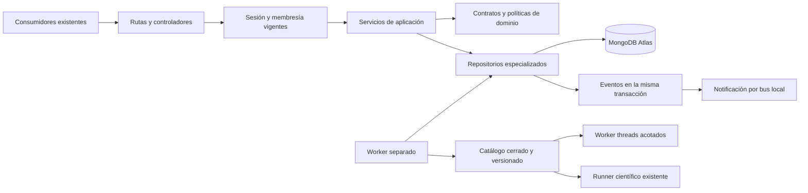

# BACKSTAGE · arquitectura backend de fase 2

25 de octubre de 2026, Bogotá. Se conserva React, MapLibre, Mapbox, la identidad existente y MongoDB Atlas. La única modificación del frontend está en su proxy servidor para transmitir `Idempotency-Key`; las pantallas no se reconstruyen.

## Capas conectadas



`computational.routes.js` y `computational.controller.js` traducen HTTP. `computationalOrchestrator.service.js` coordina casos de uso; `computationalContract.js` valida DTOs, transiciones y atributos de autorización. `resourceAuthorization.service.js` consulta identidad y membresía actuales y se reutiliza en integraciones. `computationalWorkflows.repository.js` encapsula consultas, revisión optimista, claims y leases; recibe infraestructura mediante una fábrica. El catálogo y el runtime no aceptan código, módulos ni comandos aportados por el cliente.

Esta separación usa módulos existentes y fábricas específicas. No se crean un ORM paralelo, repositorios genéricos, nuevas aplicaciones frontend, bases por industria o carpetas sin ejecución. Las pruebas arquitectónicas incluyen el nuevo grafo y comprueban ausencia de ciclos y montajes duplicados.

## Persistencia e integridad

Los flujos usan `analytics_jobs`, discriminados por `kind:bco.workflow`. Las rutas analíticas anteriores excluyen ese discriminador para no saltarse las políticas de posiciones privadas. IDs numéricos y colecciones anteriores se conservan. Los nuevos eventos usan `operational_events`, con versión, correlación y outbox. Los locks técnicos usan `soi_provider_locks`.

La creación idempotente usa `_id` determinista por organización y hash de clave. El hash de contenido incluye el origen de un reintento/repetición. Una clave repetida con otro contenido devuelve 409; una ejecución vencida/archivada no revela su contenido por replay. Cambiar un flujo exige revisión y estado PENDING. La creación y las transiciones comparten transacción con evento y auditoría canónica.

Los índices `bco_queue_v1`, `bco_retention_v1` y `bco_outbox_v1` son aditivos. La retención TTL es parcial: solo BCO; no elimina analítica heredada. La API deja de mostrar datos vencidos antes del barrido TTL. La migración se registra como `core.phase2.1` sin cambiar el esquema existente 2. El script imprime un plan por defecto y solo permite aplicar al fingerprint Atlas confirmado como pruebas.

## Orquestación y recuperación

Estados: PENDING → QUEUED → RUNNING → COMPLETED / FAILED / CANCELLED / TIMED_OUT. La cancelación también se permite desde PENDING y QUEUED. No se edita ni reabre una evidencia terminada: repetir/reintentar crea otro registro enlazado.

Límites BCO: ocho tareas por flujo, tres flujos pendientes por organización, dos flujos globales, uno por organización y dos tareas simultáneas. Como el runner Python existente admite una ejecución por organización, el scheduler no lanza dos tareas Python de esa organización al mismo tiempo. Cada tarea tiene como máximo 30 segundos y el flujo 120 segundos. La interrupción de cálculo puede requerir tiempo adicional para finalizar transacciones y liberar recursos.

Los leases de 45 segundos tienen propietario único; se renuevan cada diez segundos. Una consulta separada comprueba cancelaciones sin escribir el trabajo. Antes del cierre se detienen ambas tareas periódicas y se espera cualquier renovación en curso, para evitar competencia con la transacción final. Cada reintento transaccional utiliza un instante actualizado. Los hosts deben mantener relojes sincronizados; el fencing protege escrituras, no promete una única ejecución física tras un fallo. Un proceso distinto puede recuperar un lease vencido, conservando tareas ya completadas, con hasta tres intentos. Toda escritura final comprueba propietario, estado y vigencia, impidiendo que un worker antiguo sobrescriba una cancelación o recuperación. Los workers vuelven a comprobar usuario, organización y permiso de escritura; no conservan JWT del solicitante. El cierre de una sesión no equivale a cancelar un trabajo empresarial ya autorizado: para ello existe el comando de cancelación.

Las dependencias controlan orden y bloqueo. No existe cableado automático de resultados hacia parámetros, evaluación de expresiones, importación de código o actuación crítica. Los adaptadores computacionales son cálculos sin efectos empresariales; la publicación de evidencia se confirma posteriormente.

## Motores y contratos

El catálogo compone los motores existentes de comparación analítica, finanzas, riesgos, Monte Carlo, GIS y BSIE mediante adaptadores. La versión financiera/Monte Carlo utiliza los contratos actuales con metadatos, no una variante anterior simplificada. Se guardan parámetros, semilla cuando corresponde, restricciones aportadas, versión, hash de fuentes del motor, hash de entrada, resultado, duración y metadatos científicos disponibles.

El runtime JavaScript usa worker threads con límites de heap y tiempo, sin copiar secretos del entorno y sin imprimir parámetros. Estos límites no equivalen a un contenedor ni cubren toda la memoria externa de Node. Python conserva su runner y contratos existentes; sus versiones efectivas se registran en resultados BSIE. Los límites distribuidos BCO no deben confundirse con un límite global sobre todos los endpoints científicos heredados.

GWO, ACO, SSA, genéticos y RBF no se encontraron implementados y el catálogo los declara ausentes. OR-Tools, predicción y demás capacidades sanitarias conservan sus endpoints y autorizaciones sectoriales; no se trasladan artificialmente al núcleo compartido.

## Perception Network

`perception.geojson` valida y normaliza una instantánea aportada, conservando fuente, licencia declarada, fecha, calidad, resolución e incertidumbre explícitas. Entrega GeoJSON mediante Core API para su uso/importación en el explorador existente. No publica por sí sola un cambio en el catálogo cartográfico ni certifica topología, titularidad o precisión física.

`perception.positions` exige consentimiento, fecha, referencia de autorización, CRS84, precisión, clasificación de cada posición y retención explícita. Calcula distancia/velocidad usando el motor existente y revisa un umbral y geocerca aportados. Distingue observaciones declaradas, estimaciones y simulaciones; no rellena posiciones ni afirma disponer de GPS en vivo. Estos flujos son visibles únicamente para autor y administradores de su organización.

OSM, Open-Meteo, Mapbox y las integraciones de flotas existentes conservan sus adaptadores. El catálogo distingue configuración, disponibilidad no comprobada y conectores no integrados. Sentinel, Landsat y Copernicus/STAC no se declaran conectados. WMS/WFS continúan sujetos al catálogo y a los permisos de las fuentes existentes; no se añade un cliente de descarga arbitraria.

## Defensa adaptativa y eventos

`defense.evaluate` compara hasta cien umbrales sobre observaciones etiquetadas y costos explícitos. Selecciona con entrenamiento y muestra errores de validación, tasas y latencias aportadas. No inventa consumo de memoria o estabilidad. La búsqueda acotada no justifica introducir un algoritmo evolutivo. El resultado es una propuesta: otro administrador debe aprobar el hash exacto y queda auditado como actor real. La aprobación no aplica cambios de roles, claves, código, infraestructura o políticas sensibles.

El outbox conserva el evento junto a la mutación. Su dispatcher usa claim, lease, reintentos con backoff, ID estable y estado FAILED al agotar cinco intentos. La publicación es al menos una vez: un fallo después de notificar puede repetir el mismo ID. El sink actual es el bus local del proceso, **no un broker entre instancias ni una confirmación de entrega al navegador remoto**. El evento persistido permanece consultable por Core API; las vistas públicas omiten los leases de despacho.

## API y operación

Contrato nuevo: `GET /operations/openapi` y `GET /computational/openapi`. Inventario de algoritmos: `/computational/catalog`. Recursos: `/computational/runs`, con detalle, edición de pendiente, archivo terminal y comandos queue/cancel/retry/repeat/defense-approval. Reproducibilidad comprueba integridad histórica y compatibilidad de fuentes; **no reejecuta números** en un GET. La repetición exige comando explícito y worker. El detalle incluye acciones disponibles calculadas en backend; cada mutación vuelve a autorizarlas.

Los listados BCO usan cursor, máximo cien filas y proyección sin parámetros/resultados. `/computational/metrics` informa su muestra y denominadores; no presenta disponibilidad ficticia. Cuotas: treinta comandos por quince minutos y 120 lecturas por minuto, por usuario; en Vercel se comparte el presupuesto mediante Atlas. Las rutas y contratos anteriores permanecen disponibles.

Para ejecutar el worker con el entorno autorizado ya configurado:

```powershell
npm run compute:worker --prefix backend -- --once --organization 123
npm run compute:worker --prefix backend
```

El bucle reintenta fallos transitorios con backoff acotado; `--once` comunica un fallo mediante su código de salida. La primera línea procesa como máximo un flujo de la organización indicada y una tanda de outbox; la segunda mantiene el bucle. El ID es una referencia ilustrativa, no un dato insertado. En un servicio real hacen falta supervisor de proceso, secretos mínimos, reinicio, monitoreo y capacidad asignada. Una API en Vercel no mantiene ese proceso automáticamente. No se instaló un worker permanente ni un sistema externo de mensajería.

Referencias primarias: [atomicidad de MongoDB](https://www.mongodb.com/docs/manual/core/write-operations-atomicity/), [worker threads de Node](https://github.com/nodejs/node/blob/main/doc/api/worker_threads.md), [GeoJSON RFC 7946](https://www.rfc-editor.org/info/rfc7946/), [OpenAPI 3.1.1](https://spec.openapis.org/oas/v3.1.1.html).
