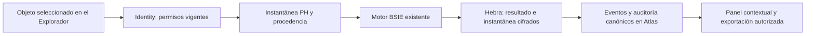

# BACKSTAGE · inteligencia espacial sobre datos PH

26 de octubre de 2026, Bogotá. Incremento de integración contextual sobre Backstage 2.0. **No hay despliegue automático en Vercel ni cambios productivos.** MongoDB Atlas de pruebas es el único destino de validación remota; los casos usan identidades, geometrías y registros sintéticos en una base exclusiva.

## Auditoría y línea base

Se comprobaron los cambios existentes antes de ampliar el sistema. La línea base pasó con 417 pruebas backend (416 aprobadas, una omitida), 36 frontend y 27 científicas Python. Había 445 entradas en el estado de Git; no se restauró, reinició ni limpió ese trabajo. Se copiaron los archivos previstos en `.vercel/spatial-context-before-1793050219715/manifest.json`.

BSIE ya contenía los algoritmos solicitados: contigüidad Queen/Rook, KNN, banda de distancia e inverso de distancia; Moran global/local, significancia por permutación, ajuste BH, Gi*, KDE y temporal. Este incremento **reutiliza ese motor y su entorno Python instalado**. No lo sustituye ni añade paquetes, Docker o infraestructura pesada.

La inspección visual detectó acentos dañados en las explicaciones recibidas de Python en Windows. Se corrigió el adaptador existente con `PYTHONIOENCODING=utf-8`, `PYTHONUTF8=1` y decodificación incremental UTF-8 de sus flujos. La regresión ejecuta Python real y exige conservar «autocorrelación», sin caracteres de sustitución. Cambia el transporte de texto; los archivos matemáticos Python conservan sus huellas.

Plan del incremento: capturar conjuntos PH autorizados; ejecutar el motor existente; guardar instantánea/resultado cifrados y evidencia auditada; integrar controles y resultados en el panel del objeto; comprobar aislamiento, casos matemáticos conocidos, reproducción, regresión y Atlas/navegador. Las fases económicas, normativas, Community y Colab conservan su orden en el [plan integral](BACKSTAGE_UNIFIED_INCREMENTAL_PLAN.md).

## Implementación y reglas de datos

El panel «Analizar los datos de este lugar» vive dentro de la entidad PH seleccionada en el Explorador. Consume `/assets/layers/horizontal-property/:id/analysis`; no crea otra aplicación ni destino de navegación. Reutiliza Identity, Security, Hebra, activos, eventos y auditoría canónicos. No depende de SATYA/Vault/Sincronía.

| Variable | Fuente y cálculo | Límite |
| --- | --- | --- |
| PQRS retenidas | Conteo por entidad de versiones actuales no eliminadas | Cero significa ausencia de registros retenidos; no acredita cobertura completa. |
| PQRS abiertas | Conteo de estados abierto/en revisión al capturar | No reconstruye estados históricos. |
| Saldo de cartera | Cargos vigentes menos pagos manuales vigentes, en enteros exactos | Se exige una moneda/escala; no suma monedas ni acredita recaudo bancario. |
| Cartera vencida | Saldo de cargos cuya fecha aportada de vencimiento ya pasó | El saldo corresponde a la captura; no reconstruye balances pasados ni determina mora legal. |

El conjunto incluye solo el tipo de entidad elegido dentro del objeto seleccionado y sus descendientes. Excluye entidades sin geometría propia y reporta sus identificadores. No copia coordenadas del ancestro, inventa viviendas o convierte polígonos a puntos para KDE. Las geometrías conservan EPSG:4326 y orden longitud/latitud; BSIE reporta la proyección métrica regional usada. Se preservan fuentes, revisión, compromiso de cada registro y huellas geométricas.

KNN y los pesos por distancia usan centroides en la proyección regional del motor, también cuando las geometrías aportadas son polígonos. Son referencias matemáticas derivadas de esas geometrías; no se presentan como posiciones GPS ni distancias viales exactas entre cada par. Queen/Rook usan la contigüidad de los polígonos.

Los cuerpos de los registros incluidos se autentican antes de usar estados/importes. El temporal usa fechas de creación verificadas contra huellas de eventos canónicos de auditoría, no una marca editable sin comprobar. Los intervalos son explícitos, ordenados, sin solapamiento, semiabiertos `[inicio,fin)` y sin futuro. Cuenta PQRS retenidas por creación; las eliminadas no reaparecen como hechos conocidos.

## Matemática, interpretación y reproducción

Se puede construir la matriz de vecinos, calcular Moran global y local/LISA, localizar hotspots/coldspots con Gi* y describir una densidad KDE ponderada por conteos PQRS de entidades puntuales. Los atípicos espaciales corresponden a categorías HL/LH de LISA; no se presentan como detector universal de fraude ni anomalías sanitarias.

La semilla, permutaciones, nivel alfa, transformación/simetría y parámetros de distancia/K quedan explícitos. El contraste es bilateral; los análisis locales usan Benjamini–Hochberg dentro de cada ejecución. No corrige el conjunto de periodos ni la búsqueda repetida de parámetros. Se conservan islas, vecindades indefinidas, errores de geometría, varianza nula y tamaño insuficiente; no se convierten en resultados exitosos ficticios.

El temporal repite Moran/LISA/Gi* sobre dos a seis periodos con geometrías estables. Su comparación es descriptiva: no activa una prueba de cambio sin un diseño y supuestos autorizados. No acredita causalidad ni riesgo futuro.

«Reproducir instantánea guardada» vuelve a ejecutar los datos congelados y la misma semilla; compara huellas del resultado numérico sin sobrescribir historia. Se excluyen duración e identificadores de ejecución de la comparación. «Calcular otra vez con datos actuales» captura un conjunto nuevo y conserva otra evidencia. La descarga incluye entrada, datos agregados/geometrías, resultado y manifiesto.

El manifiesto registra versión del motor, bibliotecas/runtime, huellas de entrada/resultado/instantánea y archivos locales del motor. La huella del repositorio no es una atestación del código ejecutado por un RPC remoto. La aceptación de este incremento ejecuta Python local real. En otros entornos se conserva el adaptador científico existente y se informa el modo; sus fuentes remotas requieren su propia verificación operativa.

Referencias primarias para revisar los conceptos, sin copiar implementaciones: [Queen/Rook de libpysal](https://pysal.org/libpysal/stable/generated/libpysal.weights.Rook.html), [Moran global en ESDA](https://pysal.org/esda/stable/user-guide/global_morans_i.html) y [Gi* en ESDA](https://pysal.org/esda/stable/user-guide/local_getisord.html). La implementación sigue siendo el BSIE existente; no se afirma equivalencia de todos sus valores p con configuraciones distintas de otras bibliotecas.

## Seguridad, persistencia y capacidad

Admin y analyst vigentes pueden revisar/calcular/consultar; viewer no accede a estos conjuntos. Se revalidan sesión, membresía y organización al leer y antes de publicar un cálculo. Una revocación durante la ejecución impide guardar/devolver su resultado. Datos de otra organización o de otro objeto no se resuelven cambiando identificadores.

La instantánea, entrada, resultado, parámetros y manifiesto se guardan juntos en una envoltura Hebra AES-256-GCM ligada a organización, objeto, identificador, autor y versión. Las filas usan el discriminador `territorial.analysis` en `operational_events`, separado de versiones PH y alertas. Las rutas generales de alertas no listan, reconocen ni resuelven estas evidencias. El logger omite cuerpos bajo PH; las rutas del análisis deshabilitan caché HTTP.

Se añaden dos índices parciales: idempotencia por organización/objeto/comando y listado por objeto. El mismo comando no crea duplicados; una clave con parámetros distintos se rechaza. No se crean colecciones paralelas de usuarios o activos.

Límites iniciales: 64 entidades seleccionadas, 2000 registros, entrada científica 40 KB y envoltura total 100 KB. KDE usa entre 4 y 12 celdas por eje; el panel inicia con 8. El motor conserva límite temporal y concurrencia. Las ejecuciones/reproducciones tienen cuota; en Vercel su control usa Atlas compartido. Límites superados fallan explícitamente y no guardan una evidencia parcial. No es una certificación de carga empresarial.

Se requieren claves Hebra reales en el servidor; las pruebas usan claves efímeras. El borrado de un cuerpo original excluye ese registro de futuras capturas, pero **no elimina automáticamente instantáneas agregadas anteriores, descargas o respaldos**. Su retención/eliminación necesita una política específica; no se certifica cumplimiento legal de conservación de datos.

## Evidencia y pendientes

Resultados definitivos en [aceptación real](evidence/spatial-context-live.json), [comprobación final](evidence/spatial-context-postflight.json), [backend](evidence/spatial-context-backend-tests.txt), [frontend](evidence/spatial-context-frontend-tests.txt), [científicas](evidence/spatial-context-science-tests.txt) y [build](evidence/spatial-context-build.txt).

**Cierre aprobado:** 425 pruebas backend, 424 aprobadas y una omitida; 36 frontend; 27 científicas y build aprobados. Ocho comprobaciones espaciales reales y dieciocho de navegador aceptadas, con UTF-8 comprobado, cadena de auditoría válida, cero errores de ejecución y namespace temporal eliminado. El caso de Moran produce −0,1041666666666667 y coincide con la referencia matricial independiente dentro de 1e−12. Se comprobaron 24 archivos científicos/compartidos conservados; el adaptador Node/Python tiene la corrección de transporte documentada.

El ensayo completo conserva los escenarios anteriores de operaciones/MFA y añade ocho comprobaciones espaciales y dieciocho de navegador. Después de corregir el transporte UTF-8, el ensayo enfocado repite esas ocho comprobaciones espaciales y las dieciocho del navegador, incluidas operaciones y acceso MFA; no repite las siete pruebas API anteriores de operaciones. Sus aceptaciones completas se conservan en los archivos fechados de evidencia y en [operaciones PH](evidence/unified-operations-live.json). Cada base sintética se elimina después de verificar su marcador de propiedad.

El ensayo es API local y navegador construido frente a Atlas exclusivo; no es un despliegue Vercel ni prueba de proveedores cartográficos/WebGL. Los resultados aparecen en el panel contextual y se exportan; no se declara aún una capa temática de resultados dibujada sobre el mapa. La aceptación observada con usuarios sin experiencia continúa pendiente.

Siguientes incrementos: datos sanitarios contextualizados, detector univariante separado cuando proceda, flujos de caja/proyecciones/optimización/cuotas, diccionario normativo de Colombia con fuentes oficiales y revisión humana, repositorios documentales Community y propuestas/intercambios Colab. Se conserva el [NO_GO productivo](BACKSTAGE_PRODUCTION_GO_NO_GO.md) hasta cerrar Atlas, privilegios, custodia de claves, respaldos, monitor, capacidad, recorridos y reversión.
