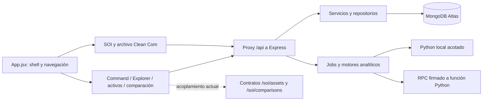

# Arquitectura real de BACKSTAGE — Fase 0

Este documento describe el árbol de trabajo auditado, no una arquitectura futura ya implementada. Referencia: `ce18b6d7b79867d940e1689d61755446acbf974c` más cambios locales preservados, rama `recovery/backstage-2-audit-20261021`.

## Aplicaciones y dependencias

| Área | Implementación comprobada |
| --- | --- |
| Frontend | React 18.3.1, React Router 7.18.3, Vite instalado 5.4.21; JSX y CSS |
| Mapa | MapLibre GL JS 6.11.2, worker separado, GeoJSON y teselas vectoriales |
| Backend | Node.js 24.x declarado; Express instalado 4.22.3, CommonJS |
| Persistencia | mongodb 6.21.0, cliente compartido, Atlas, transacciones y contadores numéricos |
| Identidad | bcryptjs 2.4.3, jsonwebtoken 9.0.3; JWT HS256 con issuer/audience |
| Transporte local | ws 8.21.3 y EventEmitter por proceso; no es un broker distribuido |
| Ciencia | Python en entorno separado local y función Python Vercel; BSIE, probabilidad y sanitary |
| Herramientas | npm y locks por frontend/backend; node:test y unittest; sin workspace formal de paquetes |

Los requisitos Python reales están en `bsie/requirements.txt`, `sanitary/requirements.txt`, `probability/requirements.txt` y `cleancom/requirements.txt`; incluyen spreg y OR-Tools en sus dominios. No se propone cambiar de framework o crear microservicios en esta fase.

Que el punto de composición importe un módulo es válido. El problema es sustituir funciones globales por ese módulo o hacer que reglas generales dependan de detalles sanitarios.

## Navegación y experiencia

`frontend/src/App.jsx` combina shell, sesión, organización, contexto y switch de páginas. Hay diez entradas de menú y 21 casos de página observados. Conserva `/dashboard?page=...`, `/soi`, `/soi/routes` y `/clean-com`.

- `mission-control`: SOI por defecto; MissionControl original detrás de un botón.
- `portfolio-assets`: inventario SOI por defecto; RealEstatePortfolio como análisis “heredado”.
- `portfolio-projects`: RetailZones conserva proyectos de varios sectores.
- `portfolio-comparator`: AdvancedComparator alterna motor configurable y original en LegacyAdvancedComparator; prioriza el configurable SOI.
- `earthart`: AirHeart conserva sus paneles y utiliza LiveTerritoryOverview, que consulta activos SOI.
- `clean-com`: se normaliza hacia `soi`.

No existe un Navigation Registry/Workspace Registry independiente. COMMAND/EXPLORE/ANALYZE/OPERATE son objetivos, no cuatro espacios terminados. Una recuperación debe conservar claves y enlaces válidos con compatibilidad explícita.

## Datos y contratos

`backend/infrastructure/soiMongo.js` es transversal por uso, aunque nombre y manifiesto mezclan plataforma/SOI. Declara identidad, colecciones generales de ubicaciones/análisis/riesgos/eventos/valoraciones/integraciones/territorio, `soi_*` y `bsie_*`. `atlasDocuments.js` da acceso nativo a dominios generales.

`backend/spatial/store.js` implementa Atlas y una clase de memoria para pruebas. El arranque operativo exige Atlas; una fixture en memoria no acredita persistencia empresarial.

La división `locations`/`soi_assets` afecta recorridos: el portafolio general utiliza locations, mientras Explorer, comparación configurable y LiveTerritoryOverview consultan `/soi/assets`. Compartir tenant no unifica esos inventarios. Se constató separación de contratos; no pérdida física de documentos.

Existen IDs públicos numéricos, contadores e índices únicos/geoespaciales/TTL; esquema de referencia versión 2. Ese número no acredita compatibilidad completa ni un backup de datos. No renombrar colecciones o IDs para corregir un problema de nomenclatura de servicios.

## API, modelos y límites

`backend/index.js` monta identidad, ubicaciones, insights, portafolio, retail/proyectos, riesgos, recomendaciones, integración, scoring, territorio, usuarios, capas, análisis, eventos, operaciones, analytics, terreno, espacial, Clean Com y SOI. El [inventario](evidence/repository-inventory.json) lista archivos y declaraciones estáticas; las factorías y recursos dinámicos requieren inspección individual.

La organización controllers/services/domain/repositories/middleware ya existe. Hay OpenAPI sanitario y contratos de dominio; no una Core API global documentada y certificada. Los envelopes y errores varían por dominio: se debe preservar compatibilidad antes de normalizarlos.

## Automatización y hosting

- Hay supervisor, comandos, recuperación automática e historial. Supervisor/WebSocket arrancan bajo `require.main === module`; el handler serverless no garantiza ejecución periódica.
- BSIE guarda jobs, cache, leases y reintentos en Atlas. Vercel puede usar `BSIE_REQUEST_WORKER=true`: procesa dentro de la solicitud mediante RPC firmado. No es una cola durable independiente de la petición.
- Hay límites de concurrencia por proceso/organización y timeout. No equivalen a un límite global distribuido.
- La UI consulta recursos cada 30 segundos y contexto ambiental/cartográfico cada cinco minutos. Es sondeo declarado, no streaming garantizado.
- OR-Tools y predicción tienen validación independiente/backtesting. Una propuesta factible no equivale a ejecución real o ahorro observado.

## Identidad y seguridad

Existen firma JWT, RBAC, organización, rate limiting, auditoría encadenada, procedencia y RPC HMAC. Conviven un guard que reutiliza membresías del JWT (`organizationContext`) y otro que consulta membresías vigentes (`soiOrganizationContext`). Requieren pruebas de revocación transversales.

La difusión WebSocket de seguridad entre tenants se reprodujo localmente; véase [REGRESSION_RISKS.md](REGRESSION_RISKS.md). No se confirmó que un transporte persistente equivalente esté activo en Vercel.

No se localizaron flujos completos de Google OIDC, Gmail OAuth, MFA, invitaciones consentidas, revocación centralizada, colaboración contextual o grafo empresarial común. Esto describe el repositorio inspeccionado y no descarta sistemas externos no disponibles aquí.

## CI/CD y variables

La publicación registrada emplea dos proyectos Vercel y snapshots generados por `prepare-soi-deployment.js`/`prepare-soi-web-deployment.js`. `deployment/vercel-api.json` compone Node y Python. `backend/vercel.json` y el `vercel.json` raíz describen otras composiciones; no son equivalentes al paquete científico.

CI prueba backend/probabilidad y compila frontend, pero no reproduce toda la validación frontend/BSIE/sanitaria. Su job de producción despliega la raíz y se dispara por push a main. La nueva directiva exige aprobación; no se inspeccionó si GitHub production tiene revisores obligatorios. En Fase 0 no hubo push.

Variables por grupo, sin valores:

- Persistencia: `MONGODB_URI`, `MONGODB_DB`/`MONGODB_SPATIAL_DB`, `SPATIAL_STORE`.
- Identidad: `JWT_SECRET`, `JWT_ISSUER`, `JWT_AUDIENCE`.
- Enrutamiento: `BACKEND_URL`, `CORS_ORIGIN`.
- Ciencia: `SOI_SCIENCE_RPC_URL`, `SOI_SCIENCE_RPC_SECRET`, `BSIE_REQUEST_WORKER`.
- Proveedores: URLs/credenciales específicas cuando se configure un conector autorizado.

El inventario registra 58 nombres detectados estáticamente; no secretos ni certificación de valores desplegados.

## Identidad visual

`index.css` define negro (`--primary: #050505`), superficies oscuras, texto blanco y rojos (`--accent-cyan: #ff2b2b`, `--accent-blue: #e11d2e`), además de colores semánticos. Los nombres cyan/blue no reflejan su valor actual. Hay valores navy y estilos literales en acceso/shell. Consolidar requiere revisar pantallas, no sustituir toda la identidad.

Existen Button, Card, Input, Select, Modal, Alert y Badge en `components/ui`, entrada orbital, estilos por página y movimiento reducido. No se ejecutó nueva auditoría visual a siete breakpoints ni medición de Core Web Vitals. El build no acredita legibilidad cartográfica, accesibilidad o rendimiento perceptual.
