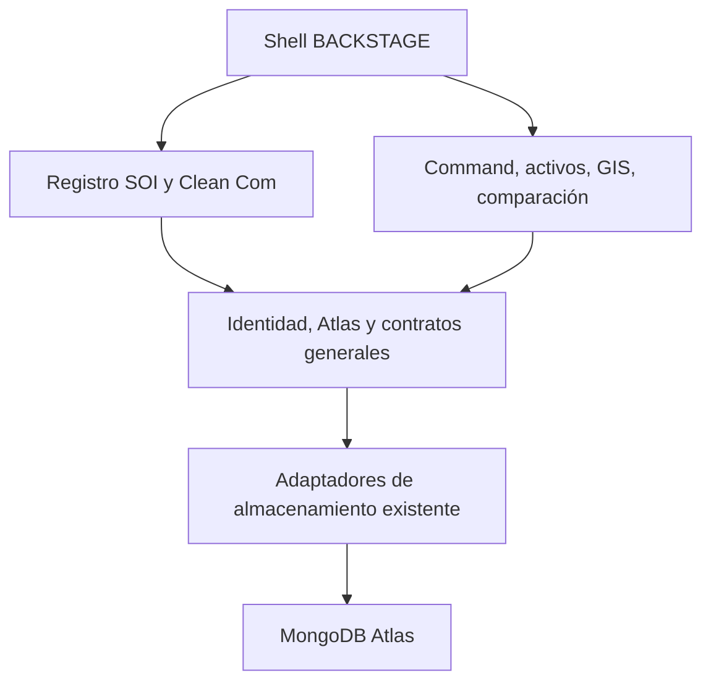

# Límites implementados en Fase 1

El shell compone navegación global y módulos. `shared/modules.json` describe únicamente SOI y el caso Clean Com, sus páginas, prefijos y roles; no añade industrias vacías. `frontend/src/modules/moduleRegistry.jsx` resuelve los componentes existentes mediante carga diferida. La autorización efectiva sigue en backend.

`platformMongo` es la infraestructura canónica. `soiMongo` exporta el mismo objeto como alias para consumidores existentes. `mongoIndexRegistry` es el punto explícito de composición del esquema: reúne índices generales y sanitarios sin ejecutar una migración. `assetSources.repository` adapta `locations` y `soi_assets`, respetando capacidades sanitarias.

`geometry` y `provenance` son contratos generales. `geography.service` conserva el motor GIS existente; `soiGeo.service` y su router son aliases. `shared/comparison.mjs` conserva el algoritmo y `soiComparison.mjs` lo reexporta. El servicio sanitario delega el guardado de comparaciones al servicio general.

Los snapshots y planes viales siguen utilizando sus colecciones físicas históricas. Su adaptación no cambia IDs ni crea motores alternativos. La separación física adicional y un registry dinámico de proveedores quedan fuera de esta fase.

`platformArchitecture.test.js` comprueba las dependencias directas del nuevo Core, ciclos alcanzables desde él, compatibilidad de aliases y montajes únicos. No pretende certificar automáticamente todo el código histórico.
